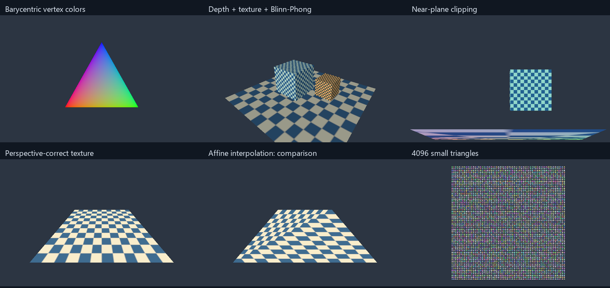

# MiniRaster

[](https://github.com/whx360/MiniRaster/actions/workflows/ci.yml)

C++17 CPU 软件光栅化渲染器。从三维三角形生成颜色图像与深度缓冲，提供参考串行、Tile 串行和 Tile 并行三种遍历方式。核心渲染流程使用 C++ 标准库实现，不依赖图形 API 或第三方渲染引擎。



## 实现重点

- **可复核的覆盖规则**：六平面齐次裁剪，8 位亚像素定点边函数与 top-left 归属规则；用深度测试前的覆盖计数检查相邻三角形的裂缝和重复覆盖。
- **结果一致的并行组织**：稳定图元分桶、Tile 独占输出、调用者持有的可复用线程池。三种遍历共用插值与着色核，保持图元提交顺序和等深规则。
- **带正确性检查的性能实验**：每个计时帧结束后，逐值比较参考颜色与深度；保留原始 CSV、重复样本和慢于参考实现的配置。

支持透视校正属性插值、Z-buffer、最近邻/双线性纹理采样、顶点色/纹理/简化 Blinn–Phong 着色，以及 UTF-8 输出路径。输出是二进制 PPM；上图为实际输出的 PNG 预览。

## 构建与运行

要求 CMake 3.20+、支持 C++17 的编译器和线程库。渲染器无需下载资源或安装 Python；场景与纹理在本地生成。

### Linux / GCC 或 Clang

```sh
cmake -S . -B build/release -DCMAKE_BUILD_TYPE=Release
cmake --build build/release --parallel
ctest --test-dir build/release --output-on-failure
./build/release/miniraster --scene cube --mode parallel --tile 32 --threads 4 --output output/cube.ppm
```

### Windows / Visual Studio 2022

在已安装 Visual Studio C++ 工具的终端中运行：

```powershell
cmake -S . -B build/vs -G "Visual Studio 17 2022" -A x64
cmake --build build/vs --config Release --parallel
ctest --test-dir build/vs -C Release --output-on-failure
.\build\vs\Release\miniraster.exe --scene cube --mode parallel --tile 32 --threads 4 --output output/cube.ppm
```

### Windows / GCC + Ninja

将 GCC、CMake、Ninja 加入当前终端的 PATH 后运行：

```powershell
cmake -S . -B build/release -G Ninja -DCMAKE_BUILD_TYPE=Release
cmake --build build/release --parallel
ctest --test-dir build/release --output-on-failure
.\build\release\miniraster.exe --scene cube --output output/cube.ppm
```

Windows GCC 的 Debug、Release、UBSan 配置已有本机验证记录。GitHub Actions 已通过 Ubuntu GCC、Windows MSVC 的 Debug/Release，以及 Ubuntu Clang UBSan；实际范围见 [验证说明](docs/validation.md)。Windows GCC/Ninja 若遇非 ASCII 路径的依赖缓存问题，可先在 ASCII 路径中构建；这与渲染器的 UTF-8 文件输出支持是两项独立检查。

也可使用 GCC/Ninja 辅助脚本。工具已加入 PATH 时运行 `./scripts/build.ps1 -Configuration Release`；便携工具链可用 `-ToolchainBin <ASCII工具目录>` 指定。脚本在工程路径包含非 ASCII 字符时创建受校验的短目录别名，构建后恢复当前进程 PATH。如果默认临时路径仍然过长，使用 `-WorkspaceAlias <更短的ASCII路径>` 或 ASCII 实体检出目录；具体原因见验证说明。`-EnableUBSan` 启用独立的 UBSan 构建目录。

## 示例

下列命令以 Linux 的可执行文件路径为例；Windows 替换为对应的 `.exe` 路径。

```sh
./build/release/miniraster --scene triangle --mode reference --shader color --output output/triangle.ppm
./build/release/miniraster --scene nearclip --mode tile --tile 16 --output output/nearclip.ppm
./build/release/miniraster --scene perspective --shader texture --output output/perspective.ppm
./build/release/miniraster --scene perspective --shader texture --affine --output output/affine.ppm
./build/release/miniraster --help
```

| 参数 | 可选值 |
|---|---|
| `--scene` | `triangle`、`cube`、`perspective`、`nearclip`、`small`、`overdraw` |
| `--mode` | `reference`、`tile`、`parallel` |
| `--shader` | `color`、`texture`、`phong` |
| `--filter` | `nearest`、`bilinear` |
| `--width / --height` | 每轴 1–4096，默认 960×640 |
| `--tile / --threads` | CLI 分别允许 1–512 / 1–64；线程数仅在并行模式下使用 |
| `--angle` | 有限弧度值 |
| `--affine` | 使用屏幕线性属性插值，供透视校正对照 |

默认场景为 `cube`，模式为 `parallel`，着色为 `phong`，线程数最多为 8。CLI 的单帧耗时仅供观察；正式对照使用 `render_bench`。

## 正确性与性能

六类 CTest 覆盖数学、裁剪、光栅化、线程池、完整场景和 CLI。测试包括独立手算的权重/UV/深度，裁剪后共享边单覆盖，退化与非有限输入，正齐次缩放，以及三种遍历的颜色/深度逐值一致。详见 [验证说明](docs/validation.md)。

2026-10-23，AMD Ryzen 7 7435H、GCC 16.2.0 Release、640×360、纹理双线性采样。三轮共 63 组配置、1323 个计时帧，每组 21 个样本。固定 Tile=32、4 个工作线程，表中为整帧耗时中位数：

| 场景 | Reference ms | Tile 串行 ms | Tile 并行 ms | `T_tile / T_parallel` |
|---|---:|---:|---:|---:|
| cube | 3.096 | 3.025 | 0.973 | 3.11× |
| small | 3.571 | 3.825 | 3.186 | 1.20× |
| overdraw | 73.076 | 73.374 | 20.040 | 3.66× |

结果支持**条件性改善**。三场景都存在慢于 Reference 的并行配置；small 中串行变换与裁剪约占参考帧时间的 36.3%。计时包括清屏、变换裁剪、分桶、光栅与帧临时对象清理，排除线程池构造、资源生成、结果核对和文件输出。详见 [实验方法与负结果](docs/benchmarks.md)及 [原始数据](benchmarks/results/)。

## 目录与设计

```text
include/miniraster/     公共接口与数学值类型
src/                   裁剪、光栅、纹理、线程池、场景和 CLI
tests/                 独立数值、边界、集成与 CLI 回归
benchmarks/            基准程序及原始 CSV
scripts/               可选构建与分析辅助工具
examples/              实际渲染预览
docs/                  架构、验证范围与实验口径
```

[架构与接口契约](docs/architecture.md)说明空间约定、数据所有权、并发不变量和异常路径。

当前没有 GPU 后端、交互窗口、外部模型导入、透明混合、阴影、MSAA、mipmap 或 SIMD。场景链仅支持当前刚体旋转的法线变换；一般非均匀缩放需另接逆转置。UBSan 验证不等于竞争检测，尚无 ThreadSanitizer 运行结果。极细三角形可能在 1/256 像素量化后退化。
